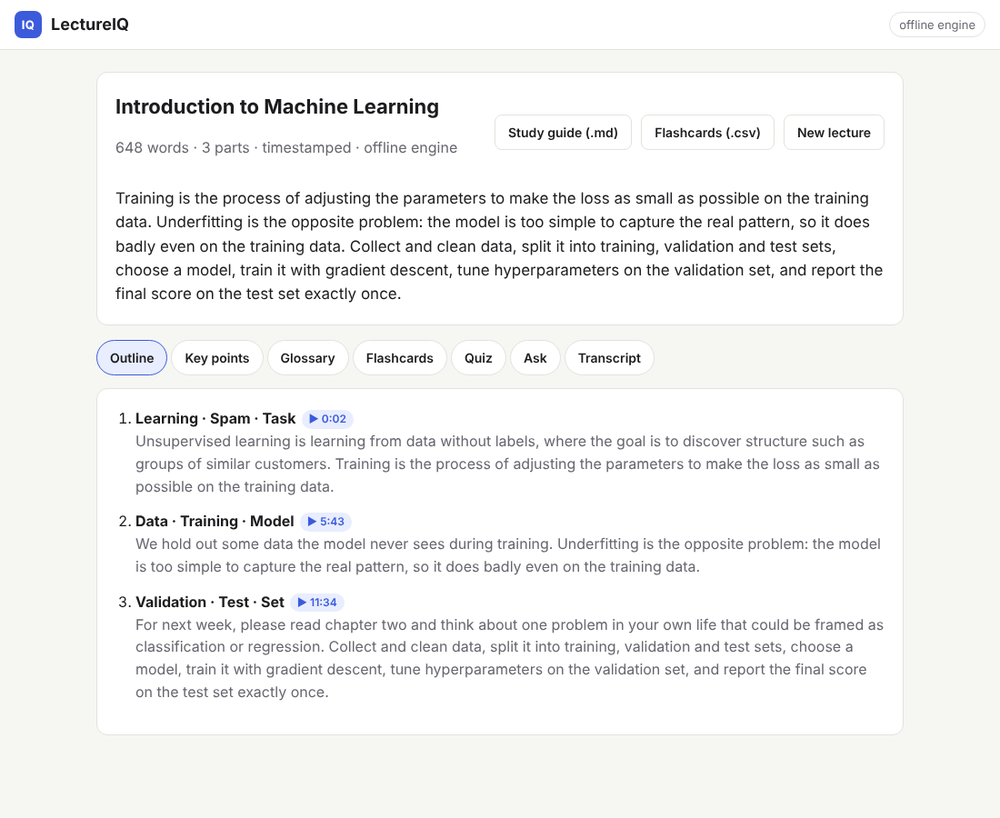

# evalkit

A small, typed Python library and CLI for evaluating LLM outputs. Describe test cases in
YAML, run them against any model, score the answers, and get JSON and HTML reports. The
command exits nonzero when the pass rate drops below a threshold, so it can gate CI.

- **Providers:** OpenAI-compatible APIs (OpenAI, vLLM, Ollama, LM Studio, ...), Anthropic,
  and an offline `fake` provider for tests and demos. Add your own with one class.
- **Scorers:** `exact_match`, `contains`, `regex`, `embedding_similarity`, `llm_judge`.
  Add your own with one class.
- **Reports:** machine-readable JSON and a self-contained HTML page (no JS, no CDN).
- **Regression tracking:** diff a run against a saved baseline and fail on any case that
  used to pass, even when the overall pass rate still clears the threshold.
- **Response cache:** `--cache DIR` reuses replies to identical requests, so iterating on
  scorers or thresholds doesn't pay for the same API calls twice.
- **Small footprint:** `httpx`, `pydantic`, `PyYAML`. Python 3.11+, fully type-hinted.

The repo also contains **[LectureIQ](#lectureiq)**, an app built on evalkit's providers
that turns lecture transcripts and recordings into study material: outline, glossary,
flashcards, a quiz, and answers that cite the lecture. evalkit also grades LectureIQ's answers
in CI ([`examples/lectureiq_qa.yaml`](examples/lectureiq_qa.yaml)).

## Quickstart

```bash
pip install -e ".[dev]"     # from a checkout; add [embeddings] for local embedding models

# Runs offline: the example suite ships canned replies for the fake provider.
evalkit run examples/suite.yaml --provider fake --report out.html

# Same suite against a real model.
export ANTHROPIC_API_KEY=...
evalkit run examples/suite.yaml --provider anthropic --report out.html --report out.json
```

```text
Running 'geography-and-format': 5 cases on fake (fake-1)
  PASS  capital-france
  PASS  capital-japan
  PASS  iso-date
  PASS  photosynthesis
  PASS  haiku

geography-and-format: 5/5 passed (100.0%), threshold 80.0% -> PASSED
Report written to out.html
```

### CLI reference

```text
evalkit run SUITE [options]
  -p, --provider NAME          provider or alias from the suite (default: suite `provider`)
  -m, --model MODEL            model override
  -O, --provider-option K=V    provider config override, repeatable (value parsed as YAML)
  -r, --report PATH            write a report; .html or .json; repeatable
  -t, --threshold FLOAT        pass-rate gate in [0, 1]; overrides the suite
  -j, --concurrency N          cases run in parallel (default 4)
      --tag TAG                only run cases with this tag; repeatable
  -b, --baseline JSON          earlier JSON report; any regressed case fails the gate
      --cache DIR              reuse replies to identical requests from DIR
  -q, --quiet                  print only the summary
evalkit compare BASE.json CURRENT.json [-r PATH]
                               diff two runs; exits 1 if any case regressed
evalkit validate SUITE         check a suite without running it
evalkit list                   show registered providers and scorers
```

Exit codes: `0` gate passed, `1` pass rate below threshold or a case regressed against
`--baseline`, `2` usage or configuration error.

### Use it as a library

```python
from evalkit import FakeProvider, load_suite, run_suite
from evalkit.report import write_report

suite = load_suite("examples/suite.yaml")
result = run_suite(suite, FakeProvider.with_responses({"France": "Paris"}))
print(result.pass_rate, result.passed)
write_report(result, "out.html")
```

## Writing a suite

```yaml
name: support-bot
threshold: 0.9              # fraction of cases that must pass (default 1.0)
provider: openai            # default for --provider

providers:                  # per-provider config, selected by --provider
  openai: { model: gpt-4o-mini }
  local:                    # an alias: `type` picks the provider class
    type: openai
    base_url: http://localhost:11434/v1
    model: llama3.1
    api_key: unused
  judge: { type: anthropic, model: claude-opus-5-5 }

defaults:                   # applied to cases that don't override them
  system: You are a helpful support agent.
  temperature: 0
  max_tokens: 300
  scorers: [{ type: contains }]

cases:
  - id: refund-window
    input: How long do I have to request a refund?
    expected: 30 days
    tags: [billing]

  - id: no-promises
    input: Can you guarantee my package arrives tomorrow?
    scorers:
      - { type: regex, pattern: "guarantee", negate: true, ignore_case: true }
      - type: llm_judge
        provider: judge
        criteria: Politely declines to promise a delivery date and offers tracking info.

  - id: multi-turn
    input:                  # a full transcript instead of a single prompt
      - { role: user, content: "My order is 1234." }
      - { role: assistant, content: "Thanks, what can I help with?" }
      - { role: user, content: "What's my order number?" }
    expected: "1234"
```

Secrets never belong in suite files: HTTP providers read keys from `OPENAI_API_KEY` /
`ANTHROPIC_API_KEY` by default, or from the variable named in `api_key_env`.

### Scorers

| Scorer | Passes when | Key options |
| --- | --- | --- |
| `exact_match` | output equals the reference (whitespace-normalised) | `value`, `case_sensitive` (true), `strip` (true) |
| `contains` | output contains the reference string(s) | `value` (str or list), `mode` (`all`/`any`), `case_sensitive` (false), `negate` |
| `regex` | `re.search` (or `fullmatch`) succeeds | `pattern`, `ignore_case`, `multiline`, `fullmatch`, `negate` |
| `embedding_similarity` | cosine similarity >= `threshold` (0.8) | `reference`, `backend` (`provider` or `sentence-transformers`), `provider`, `model` |
| `llm_judge` | a judge model's score, normalised to [0, 1], >= `threshold` (0.75) | `criteria`, `provider`, `model`, `min_score`/`max_score` (1-5), `prompt_template` |

The reference defaults to the case's `expected`. A case passes when all of its scorers pass
and the provider call succeeded; the pass rate is passed cases over all cases.

`embedding_similarity` with `backend: provider` uses the provider's `embed()` method
(OpenAI-compatible and fake implement it). `backend: sentence-transformers` runs a local
model and needs `pip install 'evalkit[embeddings]'`.

### Providers

| Name | Config (beyond `model`) |
| --- | --- |
| `openai` / `openai-compatible` | `base_url`, `api_key_env` (`OPENAI_API_KEY`), `embedding_model`, `timeout_s`, `max_retries`, `headers` |
| `anthropic` | `base_url`, `api_key_env` (`ANTHROPIC_API_KEY`), `api_version`, `default_max_tokens`, `timeout_s`, `max_retries`, `headers` |
| `fake` | `responses` (substring or regex to reply), `regex`, `default` (echo when unset), `fail_on`, `embedding_dim` |

HTTP providers retry 408/409/429/5xx and connection errors with exponential backoff.

## Using it as a CI gate

```yaml
- run: pip install evalkit
- run: evalkit run evals/suite.yaml --provider openai --report report.html
  env:
    OPENAI_API_KEY: ${{ secrets.OPENAI_API_KEY }}
- uses: actions/upload-artifact@v4
  if: always()
  with: { name: eval-report, path: report.html }
```

The job fails when the pass rate is below the suite's `threshold` (or `--threshold`).

### Caching responses

```bash
evalkit run evals/suite.yaml --cache .evalkit-cache     # first run calls the model
evalkit run evals/suite.yaml --cache .evalkit-cache     # identical requests are free
```

```text
  PASS  refund-window (cached)
...
support-bot: 3/3 passed (100.0%), threshold 90.0% -> PASSED
3/3 replies served from cache
```

The cache key is a SHA-256 of the provider's identity (name, model, and endpoint for HTTP
providers; never the API key), the messages, `temperature` and `max_tokens`. Change any of
them and the request goes to the model again. Judge calls go through the cache too.
Failed requests are never cached. Entries are plain JSON files written atomically, so
parallel runs can share a directory; delete it to start fresh.

With `temperature` above 0 a cached reply freezes one sample, so leave the cache off when
you're measuring run-to-run variance. Library users can wrap any provider:
`CachingProvider(provider, ResponseCache(".evalkit-cache"))`, or pass
`cache=ResponseCache(...)` to `run_suite`.

### Catching regressions

A pass-rate gate can't see swaps: if one case breaks while another starts passing, the
rate is unchanged. Save a JSON report from a known-good run (for example on `main`) and
pass it as `--baseline`; the run then also fails if any case that passed there fails now.

```bash
evalkit run evals/suite.yaml --report baseline.json          # on main, keep as artifact
evalkit run evals/suite.yaml --baseline baseline.json --report report.html
```

```text
geography-and-format: 4/5 passed (80.0%), threshold 50.0% -> PASSED

vs baseline: 100.0% -> 80.0% (-20.0 pts), 1 regressed, 0 fixed
  REGRESSED  capital-france  - exact_match: expected 'Paris'
```

Each case is classified as regressed, fixed, new, removed, still passing, or still
failing. The HTML report gains a "Compared with baseline" section and the JSON report a
`comparison` object. `evalkit compare base.json current.json` does the same for two
reports you already have, without calling any model.

## Architecture

This section covers evalkit; LectureIQ's layout is under [LectureIQ](#lectureiq).

```text
suite.yaml ──► loader ──► Suite / TestCase (pydantic, validated up front)
                               │
          CLI / your code ──► runner.run_suite ──► Provider.complete()   (thread pool)
                               │                        │
                               │                  Completion(text, usage)
                               ▼                        │
                           Scorer.score(ScoreContext) ◄─┘
                               │
                           RunResult ──► report.write_report ──► .json / .html
```

```text
src/evalkit/
  models.py        Suite, TestCase, Message, ScorerSpec: the YAML schema
  loader.py        YAML -> Suite; builds every scorer once so bad params fail at load time
  runner.py        runs cases concurrently; provider/scorer errors fail the case, not the run
  results.py       ScoreResult, CaseResult, RunResult (pass rate, gate, summaries)
  compare.py       compare_runs / load_run: case-level diff against a baseline report
  cache.py         ResponseCache (on-disk JSON) and CachingProvider wrapper
  registry.py      name -> class registry with entry-point plugin discovery
  providers/       base.Provider ABC, fake, openai_compat, anthropic, shared HTTP retry logic
  scorers/         base.Scorer ABC, basic (exact/contains/regex), embedding, judge
  report/          json_report, html_report
  cli.py           argparse front end and exit codes
```

Design choices:

- **Validate early.** Suites, scorer parameters, and provider configs are pydantic models
  with `extra="forbid"`, so typos fail at load time with a precise message, before any API
  spend.
- **Scorers are data.** A scorer's fields are its YAML options. Scorers get a
  `ScoreContext` with the case, the output, and a provider lookup, so model-based scorers
  (judge, embeddings) can use the provider under test or any named provider.
- **Failures are results.** A timeout or a bad judge reply marks that case failed with the
  error in the report; the run still completes and the gate decides.
- **Sync + threads.** Providers expose a blocking `complete()`; the runner parallelises with
  a thread pool. Simple to implement and debug, and plenty for I/O-bound API calls.

### Extending

```python
from evalkit import Completion, Provider, ProviderConfig, ScoreContext, Scorer
from evalkit import register_provider, register_scorer
from evalkit.results import ScoreResult


@register_scorer("max_length")
class MaxLength(Scorer):
    name = "max_length"
    chars: int

    def score(self, ctx: ScoreContext) -> ScoreResult:
        ok = len(ctx.output) <= self.chars
        return self.result(1.0 if ok else 0.0, ok, f"{len(ctx.output)} chars")


class EchoConfig(ProviderConfig):
    prefix: str = ""


@register_provider("echo")
class EchoProvider(Provider):
    name = "echo"
    Config = EchoConfig

    def complete(self, messages, *, temperature=None, max_tokens=None) -> Completion:
        return Completion(text=self.config.prefix + messages[-1].content)
```

Registration happens on import. To make a plugin available to the CLI without importing it
yourself, expose it as an entry point:

```toml
[project.entry-points."evalkit.scorers"]
max_length = "my_package.scorers:MaxLength"

[project.entry-points."evalkit.providers"]
echo = "my_package.providers:EchoProvider"
```

## LectureIQ

LectureIQ turns a lecture transcript into a study kit and lets you ask the lecture
questions. It is a Python backend (Starlette) with a vanilla-JS frontend, and it uses
evalkit's providers, so any OpenAI-compatible API or Anthropic can power it.



```bash
pip install -e ".[lectureiq]"

lectureiq serve                         # http://127.0.0.1:8000, offline engine, no API key
lectureiq serve --db lectures.db        # keep lectures across restarts (SQLite)
lectureiq serve --transcribe            # also accept recordings (Whisper; reads OPENAI_API_KEY)
lectureiq serve --provider anthropic    # LLM engine (reads ANTHROPIC_API_KEY)
lectureiq serve --provider openai -m gpt-4o-mini --cache .evalkit-cache
lectureiq serve --provider openai -O base_url=http://localhost:11434/v1 -O api_key=unused \
    -m llama3.1                         # a local model through Ollama
```

In the browser, paste a transcript or drop a `.txt`, `.md`, `.srt` or `.vtt` file, or a
recording (`.mp3`, `.m4a`, `.wav`, `.webm`, ...) when the server runs with `--transcribe`. You
can also click **Try the sample lecture**. Recent lectures are listed on the home page with
Open and Delete. You get:

| Tab | What it shows |
| --- | --- |
| Outline | Sections with summaries and a ▶ timestamp that jumps to the transcript |
| Key points | The main takeaways, each linked to where it was said |
| Glossary | Terms and their definitions as used in the lecture |
| Flashcards | Flip cards (click or Space, ← → to move, shuffle); export to Anki as CSV |
| Quiz | Multiple choice with scoring and explanations |
| Ask | Questions answered from the lecture, citing timestamps; says so when it isn't covered |
| Transcript | The lecture in parts, highlighted when you follow a citation |

The study guide downloads as Markdown and the flashcards as CSV (Anki's *File → Import*
accepts it as is). Transcribed lectures can also be downloaded as WebVTT subtitles.

The same features work from the command line:

```bash
lectureiq analyze lecture.vtt --markdown guide.md --csv cards.csv --json pack.json
lectureiq analyze @sample                          # the bundled demo lecture
lectureiq ask lecture.vtt "Why do we need a test set?"
cat notes.txt | lectureiq analyze - --title "Week 3"

lectureiq transcribe week3.m4a                      # -> week3.vtt (timestamped transcript)
lectureiq analyze week3.m4a --transcribe            # transcribe, then build the study pack
```

### Recordings

`--transcribe` sends audio to an OpenAI-compatible `/audio/transcriptions` endpoint and asks
for segment timestamps (`verbose_json`), so a transcribed lecture gets the same timestamp
links as a `.vtt` file. The default is OpenAI's `whisper-1` (up to 25 MB per file). To use a
self-hosted Whisper server that speaks the same API, pass `--transcribe-url` and
`--transcribe-model`, plus `--transcribe-key-env` for the variable holding its key. If a
server only returns plain text, the lecture still works without timestamps.
`--language en` skips language detection.

### Saving lectures

Without `--db`, the server keeps the 50 most recent lectures in memory. With
`--db lectures.db`, each lecture's parsed transcript and study pack go into one SQLite file,
so the recent-lectures list, Ask and the exports work after a restart. The file is plain
SQLite (WAL mode): back it up by copying it while the server is stopped.

### Grading LectureIQ with evalkit

LectureIQ registers itself as an evalkit provider named `lectureiq`, so evalkit suites can
grade its answers. [`examples/lectureiq_qa.yaml`](examples/lectureiq_qa.yaml) asks ten
questions about the sample lecture. It checks that answers lead with the right definition,
contain the key facts, cite the right timestamps, and decline off-topic questions:

```bash
evalkit run examples/lectureiq_qa.yaml                          # offline engine
evalkit run examples/lectureiq_qa.yaml --provider lectureiq-claude --report qa.html
evalkit run examples/lectureiq_qa.yaml --report qa.json         # save a baseline...
evalkit run examples/lectureiq_qa.yaml --baseline qa.json       # ...and catch regressions
```

The provider's options are `transcript` (a path or `@sample`), `engine` (`offline` or any
evalkit provider), `model`, `engine_options`, `chunk_words`, `k` (passages per question) and
`cite` (append a `Sources: m:ss` line). CI runs the suite on every push. It has already
caught a bug: "What are hyperparameters?" was answered with a recap sentence that only
mentioned the word, instead of the sentence that defines it.

### Engines

- **offline** (default) needs no model or API key. It is a heuristic baseline. Summaries
  and key points are the most representative sentences. The glossary comes from
  definitional sentences ("X is ..."). The quiz uses other definitions from the lecture
  as wrong answers. Q&A returns the best-matching sentences with their timestamps.
- **LLM** (any evalkit provider) sends each part of the lecture to the model, which
  returns JSON notes (summary, key points, terms, flashcards, quiz). A final call merges
  the summaries into a title, a TL;DR and an outline. Replies are validated with pydantic.
  An invalid reply gets one repair attempt. A part that still fails is skipped with a
  warning, and malformed items are dropped. Q&A retrieves the most relevant parts with
  BM25 and asks the model to answer only from them, citing part ids that are mapped back
  to timestamps. `--cache DIR` reuses evalkit's response cache.

### HTTP API

| Method and path | Purpose |
| --- | --- |
| `GET /api/lectures` | Recent lectures (id, title, date, words, engine) |
| `POST /api/lectures` | Analyze a transcript or, with `--transcribe`, a recording: JSON `{"text", "title"}`, or a form with `file` or `text` |
| `POST /api/lectures/sample` | Analyze the bundled sample lecture |
| `GET /api/lectures/{id}` | The lecture's parts and study pack |
| `DELETE /api/lectures/{id}` | Delete a lecture |
| `POST /api/lectures/{id}/ask` | `{"question": "..."}` returns an answer with citations |
| `GET /api/lectures/{id}/export.md` | Markdown study guide |
| `GET /api/lectures/{id}/flashcards.csv` | Flashcards as CSV |
| `GET /api/lectures/{id}/transcript.vtt` | Transcript as WebVTT (timestamped lectures only) |
| `GET /api/health` | Engine, model, and whether audio and persistence are on |

Transcript uploads are capped at 2 MB, and recordings at 25 MB.

### How it fits together

```text
transcript.py   parse SRT / WebVTT / plain text -> Lecture -> timestamped Chunks
audio.py        WhisperTranscriber: recordings -> timestamped segments
engines.py      Engine protocol + PackOptions (caps on how much to generate)
offline.py      OfflineEngine: extractive, deterministic, no model
llm.py          LLMEngine: map chunks -> JSON notes, reduce -> outline; answers with citations
retrieval.py    BM25 over chunks for "ask"
pipeline.py     analyze(), ask(), make_engine() (evalkit provider + optional response cache)
export.py       Markdown study guide, Anki CSV, WebVTT
store.py        MemoryStore / SQLiteStore for the web app
evalkit_provider.py   LectureIQ as an evalkit provider (entry point `lectureiq`)
web/            Starlette app + static index.html / app.js / style.css
cli.py          lectureiq analyze | ask | transcribe | serve
```

## Development

```bash
pip install -e ".[dev]"
pytest              # offline: FakeProvider and httpx.MockTransport, sockets are blocked
ruff check . && ruff format --check .
mypy                # strict
```

See [CLAUDE.md](CLAUDE.md) for conventions.

## License

MIT
